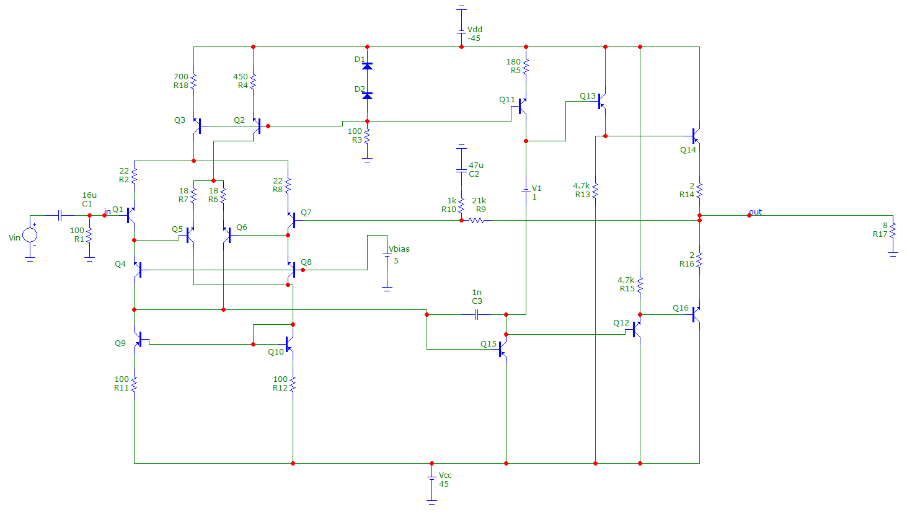
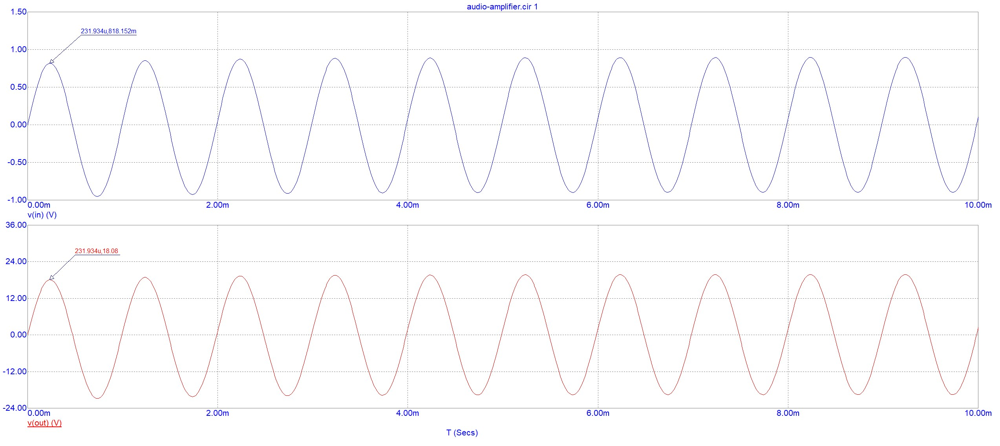

# Audio Power Amplifier — Design and Simulation

An academic project completed for the Analog Circuit Design course.

The project involved designing and simulating a discrete-transistor
audio power amplifier for a 25 W output target into an 8-ohm load.

## Specifications

- Target output power: 25 W
- Load resistance: 8 ohms
- Supply voltage: ±45 V
- Required frequency range: 100 Hz–22 kHz
- Simulator: Micro-Cap v.12

## Circuit Overview

The amplifier consists of:
- A differential input stage with cascode-connected transistors
- A voltage-amplification stage
- An emitter-follower output stage

The input-stage topology was specified in the course assignment.

## Work Completed

- Selected transistor models and adjusted component values.
- Calculated the negative-feedback network.
- Analysed DC operating points, frequency response and transient behaviour.
- Documented the schematic, calculations and simulation results.

## Simulation Results

- Voltage gain: approximately 26.8 dB
- Output power: approximately 24.5 W into 8 ohms
- Output-power test: 1 kHz sinusoidal input

All reported results are from circuit simulation.
The amplifier has not been physically assembled or bench-tested.

## Schematic

## Frequency Response

## Transient Response

## Reproducing the Simulation

1. Download or clone this repository.
2. Open the circuit file in the simulation folder using
   MIcro-Cap version 12 or up.
3. Run the saved analyses.

## Files

- simulation/ — editable circuit and required model files
- images/ — schematic and simulation plots

